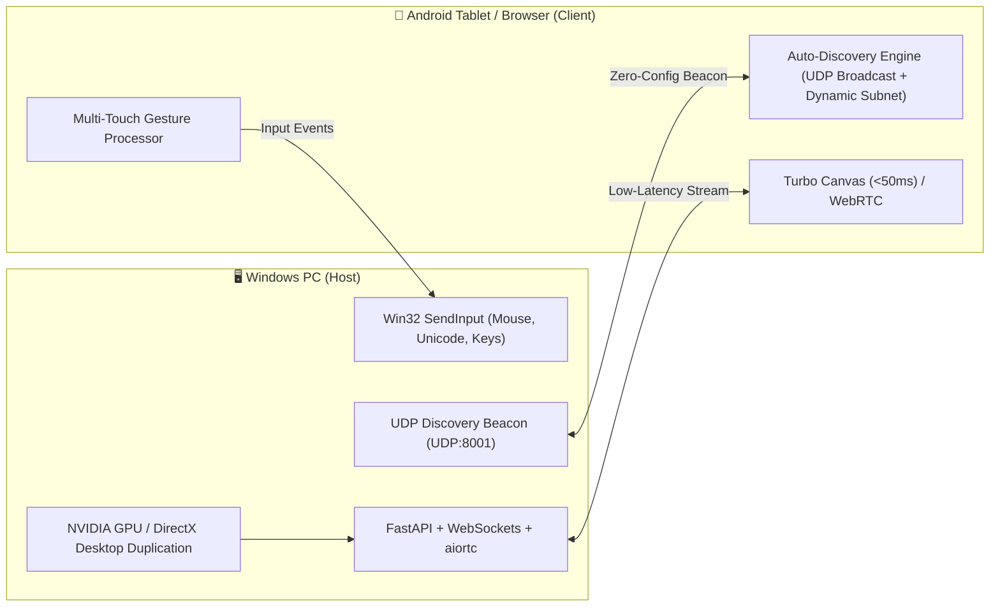

# AirDesk ⚡

[](https://opensource.org/licenses/MIT)
[](https://www.python.org/)
[](https://github.com/ra1nty/DXcam)
[](releases/AirDesk.apk)
[](#-performance--architecture)

> **A lightweight, GPU-accelerated, self-hosted remote desktop system with zero-configuration LAN auto-discovery.**  
> Seamlessly control your Windows PC or laptop from bed or anywhere in your home using an Android tablet, phone, or web browser.

---

## 🌟 Why AirDesk?

Traditional remote desktop tools (like Chrome Remote Desktop, TeamViewer, or AnyDesk) route data through third-party cloud servers, require accounts, and often suffer from lag, latency, and aspect ratio letterboxing on tablets. 

**AirDesk** is built for pure local speed, privacy, and flawless tablet usability:
- **100% Private & Self-Hosted**: Runs entirely within your home Wi-Fi. Zero data ever leaves your local network. No accounts, no subscriptions.
- **⚡ Hardware-Accelerated 60 FPS Capture**: Direct Desktop Duplication API via `DXCam` leveraging your dedicated GPU (NVIDIA RTX / AMD / Intel) with zero CPU overhead.
- **🔍 Zero-Config LAN Auto-Discovery**: No need to memorize or look up IP addresses! The Android app and host PC use UDP beacon discovery to detect each other within milliseconds on **any** router or subnet (`192.168.x.x`, `10.x.x.x`, etc.).
- **📱 100% Tablet Taskbar & Start Menu Visibility**: Designed specifically with dynamic viewport calculation (`100dvh`) to ensure that Windows 11's bottom Taskbar, Start button, and system tray icons are never cropped or hidden by tablet navigation bars.
- **🎮 Intuitive Bedside Gestures**: Trackpad mode, single tap to click, two-finger right click, two-finger smooth scroll, long-press drag-and-drop, and floating discreet FAB menu.
- **⌨️ Unicode Text & Shortcuts**: Seamlessly type in English, Bengali, or any language; execute Windows shortcuts (`Win+D`, `Alt+Tab`, `Task Manager`, `Ctrl+C/V`) with dedicated quick buttons.
- **🔋 Windows Auto-Startup Service**: One-click installer configures Windows Defender Firewall and sets up background auto-start on PC boot with 0 RAM impact when idle.

---

## 📸 Architecture



---

## 📦 What's Included

| File / Folder | Purpose |
| :--- | :--- |
| **[`setup.bat`](setup.bat)** | **One-Click Universal Setup**: Checks Python, installs dependencies, and configures Windows Firewall automatically. |
| **[`start.bat`](start.bat)** | Interactive launcher showing local IP and terminal ASCII QR code for camera scanning. |
| **[`install_startup.bat`](install_startup.bat)** | UAC-elevated installer to make AirDesk automatically run invisibly whenever Windows boots. |
| **[`stop.bat`](stop.bat)** | Safely stops any running background server processes. |
| **[`AirDesk.apk`](AirDesk.apk)** | **Universal Android APK**: Pre-compiled, signed (V1/V2/V3), and ready to install on Android phones and tablets. |
| **[`releases/`](releases/)** | Holds release-ready APK packages for instant download. |
| **[`android_app/`](android_app/)** | Complete native Android source code (compatible with Android Studio or CLI D8/AAPT2). |
| **[`server.py`](server.py)** | FastAPI backend, WebSockets, WebRTC signaling, and UDP discovery engine. |
| **[`streamer.py`](streamer.py)** | DirectX Desktop Duplication capture with GDI fallback and mouse cursor overlay. |
| **[`input_controller.py`](input_controller.py)** | Win32 input simulator for high-precision trackpad, absolute touch, and Unicode typing. |

---

## 🚀 Quick Start Guide

### 1. Windows PC Host Setup (First Time Only)

1. Clone or download this repository:
   ```bash
   git clone https://github.com/YOUR_USERNAME/AirDesk.git
   cd AirDesk
   ```
2. Double-click **`setup.bat`**:
   - Automatically installs required Python packages (`pip install -r requirements.txt`).
   - Automatically opens Windows Defender Firewall for TCP Port 8000 and UDP Port 8001.
   - Generates default configuration (`config.json`).
3. Start the server:
   - Double-click **`start.bat`** to run with terminal & QR code, **OR**
   - Double-click **`install_startup.bat`** if you want it to run invisibly every time Windows boots!

---

### 2. Android Client Setup (Tablet or Phone)

You can connect in two different ways:

#### Option A: Dedicated Native Android App (Best Experience)
1. Transfer and install **[`AirDesk.apk`](releases/AirDesk.apk)** onto your Android tablet or phone (or open `http://<PC_IP>:8000/apk` in your mobile browser to download directly).
2. Open the **AirDesk** app.
3. Tap **🔍 Auto Discover PC**: The app automatically detects your PC on your home Wi-Fi—no IP typing required!
4. Tap **⚡ Connect to Desktop**. That's it!

#### Option B: Any Web Browser (Chrome, Safari, Edge, Firefox)
1. Open your browser on your phone, tablet, or secondary laptop.
2. Navigate to:
   ```text
   http://<YOUR_PC_IP>:8000
   ```
   *(Your PC's IP and a QR code are displayed in `start.bat`).*
3. Enter your Security PIN (Default: `123456`) and click **Connect**.

---

## 🖐️ Gesture & Control Guide

| Gesture | Action |
| :--- | :--- |
| **1-Finger Drag** | Smooth mouse cursor movement (Trackpad mode) |
| **1-Finger Tap** | Left mouse click |
| **2-Finger Tap** | Right mouse click |
| **2-Finger Swipe Up / Down** | Smooth page scrolling |
| **Long-Press & Drag** | Window dragging / text selection |
| **⚡ Floating Button** | Opens slide-out Control Panel (Keyboard, Shortcuts, Settings) |
| **Side Mouse Bar (Optional)** | Dedicated bedside vertical L/R click buttons and thumb-scroll slider |

---

## 🛠️ Configuration (`config.json`)

You can customize your server settings in `config.json`:

```json
{
  "host": "0.0.0.0",
  "port": 8000,
  "pin": "123456",
  "auth_required": true,
  "fps": 30,
  "quality": 75,
  "scale": 1.0,
  "default_mode": "touchpad"
}
```

- **`fps`**: Target frame rate (`15`, `30`, or `60`).
- **`quality`**: JPEG quality level (`50` to `90`).
- **`scale`**: Desktop scaling factor (`1.0` for native, `0.75` for reduced bandwidth).
- **`pin`**: Custom security PIN code.

---

## 🔨 Building the Android APK from Source

If you want to modify the Android app or build it yourself:

```bash
python build_apk.py
```

This compiles resources, builds Java sources, generates DEX bytecode with D8, packages the APK, and signs it with V1/V2/V3 schemes.

---

## 🤝 Contributing

Contributions, feature requests, and bug reports are welcome!
1. Fork the Project.
2. Create your Feature Branch (`git checkout -b feature/AmazingFeature`).
3. Commit your Changes (`git commit -m 'Add some AmazingFeature'`).
4. Push to the Branch (`git push origin feature/AmazingFeature`).
5. Open a Pull Request.

---

## 📄 License

Distributed under the **MIT License**. See [`LICENSE`](LICENSE) for more details.
